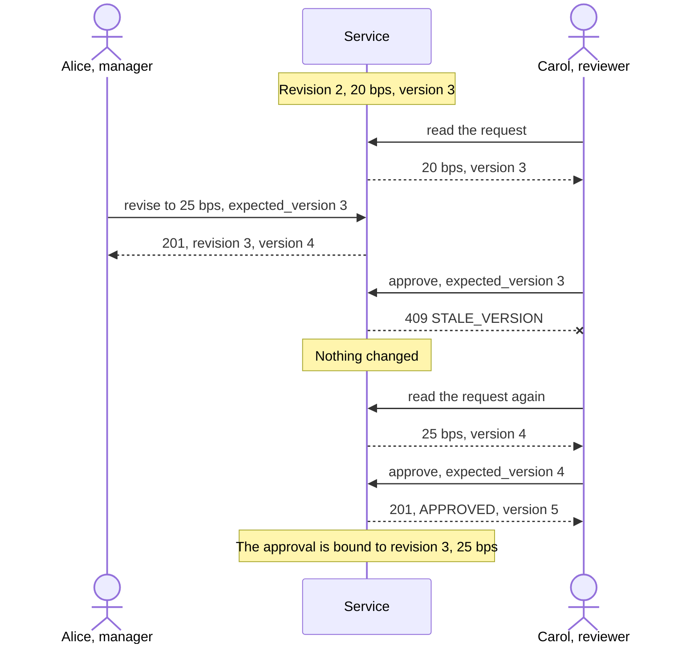
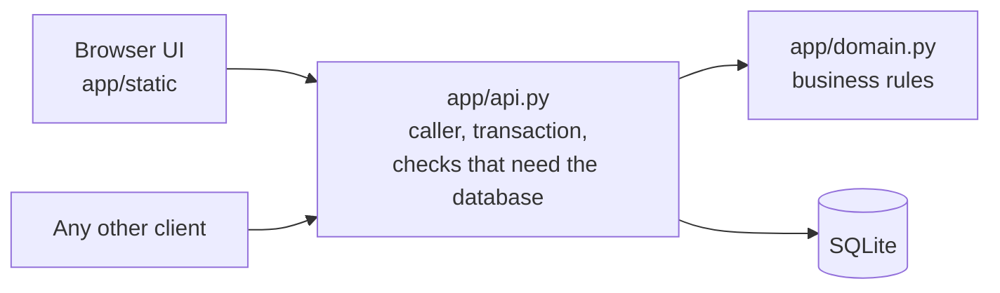

# Mortgage pricing exception requests

A small internal service for a mortgage lender. A relationship manager requests a rate discount for a mortgage application, a reviewer approves or declines it, and the mortgage process reads the approved discount.

The repository holds an HTTP API, a browser UI on top of it, and an experiment in which an AI agent writes regression tests that a script then checks. It is written in Python 3.12 with FastAPI and SQLite: the language I know best, with nothing to install besides Docker.

Where to look:

- [Try it in five minutes](#try-it-in-five-minutes): start it, and find your way in the UI.
- [The decision](#the-decision): how the two stakeholders' wishes are both met.
- [Requirements and their evidence](#requirements-and-their-evidence): each requirement with the tests that show it.
- [How it works](#how-it-works): the path of a call through the code.
- [Working with AI agents](#working-with-ai-agents): how the agents were used and checked.
- [Known limits](#known-limits): what this does not do.

## Try it in five minutes

Requires Docker. Built and checked on Ubuntu under WSL2 and on Ubuntu in CI; not tried on macOS or native Windows. The Docker commands are the same there; `scripts/smoke.sh` and the `APP_PORT=8001` prefix need a bash shell.

```bash
docker compose up --build -d --wait
```

Open http://localhost:8000/ and choose who to act as in the top bar. The seed data has five users and five applications: one without a request, and requests that are pending, declined and approved.

- **The main story in the browser:** the seven steps at the top of [docs/demo-script.md](docs/demo-script.md): create, decline, revise, a second revise while the reviewer still has the first one open, an approval that is refused until the reviewer reloads, and the read by the mortgage process. Steps 8 to 12 go on negotiating after the approval.
- **The API:** http://localhost:8000/docs. Every call except `GET /users` and `GET /health` needs an `X-User-Id` header, for example `alice`, `carol` or `mortgage-process`.
- **The same story as a script:** `scripts/smoke.sh` runs 24 checks against the service in Docker, including a retried create and the first five steps of the example. It needs `curl` and `jq`, and it deletes the local volume.

```bash
docker compose exec app python -m app.seed --reset   # back to the seed data
docker compose down -v                               # stop and delete the data
```

If port 8000 is taken, put `APP_PORT=8001` in front of the `docker compose up` and `scripts/smoke.sh` commands and use that port in the addresses.

### Finding your way in the UI

Until a user is chosen under "Acting as", the page only asks for that choice, and the choice decides what the screens offer. It is kept per browser tab, so two tabs can act as two users.

| Act as | Role | What they can do |
|---|---|---|
| Alice, Bob | Relationship manager | Create a request; revise a request they created |
| Carol | Reviewer | Approve or decline a pending request |
| Dave | Relationship manager and reviewer | Both, but not decide on a request he created |
| Mortgage process | The downstream system | Read the approved discount of each application |

The top bar leads to two screens, and a third opens from either of them:

- **Requests**, the home screen: every request, latest change first. "Asked for" is the discount of the latest revision; "Approved in force" is the discount the mortgage process reads, which can come from an earlier revision. "Next step" says what a request needs from the acting user. The application id opens the request.
- **Request detail:** "Latest revision" with its discount and reason, and "Next step" with the "Revise" button for the manager who created the request, or the form to approve or decline for a reviewer. "History" below lists every revision with its decision and marks the one in force.
- **Applications:** every application with "View request", or "New request" for a relationship manager when it has none. For the mortgage process each row shows the approved discount, and choosing that user opens this screen.

An action that is not part of the user's role is hidden. One that is part of the role but not possible now is replaced by a sentence that says why, for example "Another reviewer must decide on your request." There is no automatic refresh: "Refresh" reads a screen again.

## Four terms

This page uses four terms. [docs/state-model.md](docs/state-model.md) defines the first three in full.

- **Revision:** one proposal, a discount and a reason. A revision never changes; a change to a request is a new revision with the next number.
- **Version:** a counter on the request that increases with every revise and every decision. A client sends the version it saw, and the server refuses the call if the request changed since.
- **Approval in force:** the approved revision with the highest number. It is what the mortgage process reads. It is not the highest discount and not always the latest revision.
- **bps:** basis points. 25 bps is 0.25 percentage points.

## The decision

The assignment has two stakeholders who disagree. One wants the relationship manager to be able to change the discount after submitting. The other wants an approval to always apply to the exact request that was reviewed.

**A request is changed only by adding a new revision, and every decision is bound to the revision that was reviewed. An approved request can be revised too: its approval stays in force until a later revision is approved.**

A revision never changes, so the content a reviewer saw cannot change underneath their decision. Every change raises the request's version, and a reviewer who decides from an outdated screen is refused with `409 STALE_VERSION` and has to look at the current revision first.

The manager can also revise while the request is still waiting. Declined at 40 bps, revised to 20 and again to 25 before anyone decided: revision 2 stays without a decision, and a reviewer who still sees 20 bps is refused with `409 STALE_VERSION`. Nobody can approve an amount they have not seen.



The negotiation can go on after an approval. Approved at 25 bps, the manager asks for 35: the request is pending again and the mortgage process still reads 25. If the reviewer declines, 25 stays. If a later revision at 30 is approved, the mortgage process reads 30. It never reads a discount that no reviewer approved. That the earlier approval stays in force meanwhile is my assumption (A10), and a reviewer cannot cancel an approval; both would be confirmed with the client.

More in [docs/assumptions-and-scope.md](docs/assumptions-and-scope.md), section B, and in [docs/state-model.md](docs/state-model.md), which has the state diagram, the invariants I1 to I11 and this example in nine steps.

**The example as a page:** [docs/story.html](docs/story.html) walks the nine steps one at a time and, on its second tab, shows what the manager and the reviewer each see while a decision is refused as stale. GitHub shows only its source: clone the repository and open the file in a browser.

## Requirements and their evidence

R1 to R6 are the requirements of the assignment, as numbered in [docs/assumptions-and-scope.md](docs/assumptions-and-scope.md). The tests are in `tests/`.

| Requirement | Behaviour | Evidence | Related invariants |
|---|---|---|---|
| R1 Create a request | `POST /requests`; one request per application | `test_relationship_manager_creates_a_pending_request`, `test_second_request_for_an_application_is_rejected` | I1 |
| R2 Approve or decline; who and when | `POST /requests/{id}/decisions`; the server sets who and when; the creator cannot decide | `test_reviewer_approves_a_pending_request`, `test_reviewer_declines_with_a_comment`, `test_creator_cannot_decide_on_their_own_request`, `test_only_one_of_two_concurrent_changes_wins` | I3, I9 |
| R3 Approved discount for the mortgage process | `GET /applications/{id}/approved-discount` gives the approval in force: the latest approved revision, never a pending or declined one | `test_mortgage_process_reads_the_approved_discount`, `test_declined_request_is_revised_approved_and_read_downstream`, `test_approval_stays_in_force_while_a_later_revision_is_not_approved` | I11 |
| R4 History | `GET /requests/{id}` returns every revision with its decision | `test_request_detail_shows_the_full_history`, `test_earlier_revisions_never_change` | I2 |
| R5 No duplicate on a retry | `Idempotency-Key` on create; the first response is stored in the same transaction as the request and returned again; the same key with other fields is refused | `test_same_key_and_fields_replays_the_original_response`, `test_same_key_with_different_fields_is_rejected`, `test_request_is_not_stored_without_its_idempotency_record`, the replay steps of `scripts/smoke.sh`, the second [guard run](guard/runs/2026-10-05-idempotent-replay/result.md) | I10 |
| R6 Easy to run locally | One command, no setup | The `docker` job in CI builds the image and calls it; `scripts/smoke.sh` | |
| The stakeholder decision | A revision never changes; a decision needs the current version; an approved request is changed only by a new revision with its own approval | `test_earlier_revisions_never_change`, `test_stale_version_cannot_approve`, `test_negotiation_continues_after_an_approval`, steps 4 to 6 and 8 to 12 of the [demo script](docs/demo-script.md) | I2, I3, I7, I11 |

## How it works



The path of a call that changes data, for example an approval:

1. The browser UI calls the public API, like any other client. It has no access of its own, so every rule is enforced by the API.
2. `app/api.py` identifies the caller from the `X-User-Id` header and works in one write transaction. `app/db.py` begins that transaction so that it takes SQLite's write lock before it reads anything, so two changes to one request cannot both be checked against the same state.
3. `app/domain.py` holds the business rules: the role, who created the request, four-eyes, the version and the status. It knows nothing about HTTP. A call that fails a check changes nothing.
4. The checks and the write happen in that one transaction. The response is built before the commit and returned only after the commit succeeds.

A call that only reads uses a separate read session and sees one snapshot of the data.

Why the lock matters, and what replaces it on PostgreSQL, is under [Before production](#before-production).

## Assumptions and scope

None of these is stated in the assignment. They are my choices, and each would be confirmed with the client.

- **A1:** an application has at most one pricing exception request.
- **A2:** four-eyes: whoever created a request cannot decide on it.
- **A4:** a declined request can be revised and resubmitted. An approved request can be revised too; the new revision needs its own approval.
- **A7:** the caller is identified by the `X-User-Id` header. This is not authentication.
- **A10:** a new revision does not withdraw the approval in force; a later approval replaces it.

All ten assumptions, each with what changes if it is wrong, and the features I deliberately did not build (cancelling an approved discount, withdrawing, authority limits, notifications, expiry, pagination) are in [docs/assumptions-and-scope.md](docs/assumptions-and-scope.md).

## Tests

Requires Python 3.12 and [uv](https://docs.astral.sh/uv/).

```bash
uv venv --python 3.12 && source .venv/bin/activate
uv pip install -r requirements-dev.txt
pytest
```

222 tests. The main levels: the business rules on their own (`test_domain.py`), every endpoint against a real SQLite file, concurrent changes to one request (`test_api_concurrency.py`), and the three main stories from create to the downstream read (`test_end_to_end.py`). The rest cover the tables, the SQLite settings, the seed data and the serving of the UI. CI runs lint, the tests and a dependency audit in one job, and in a second job builds the Docker image and calls it. The UI has no automated browser tests; it was checked by hand with [docs/demo-script.md](docs/demo-script.md).

To continue the work, start with [AGENTS.md](AGENTS.md): it names the documents that define the behaviour and holds the workflow, the rules and all [commands](AGENTS.md#commands). The endpoints, error codes and order of checks are in [docs/api-contract.md](docs/api-contract.md), the UI's rules in [docs/ui-design.md](docs/ui-design.md).

## Working with AI agents

I built this with AI agents: Claude Code as the builder and other models as independent reviewers. I made every decision; nothing was merged without my review. [docs/ai-usage.md](docs/ai-usage.md) records who did what and how the output was checked, with the cases where an agent was wrong.

- **Tests before code.** Tests are reviewed before anything is implemented, with one question: which wrong implementation would still pass?
- **Hand mutants.** After implementing, the agent breaks the code on purpose; each break must make a test fail.
- **Review by another model** for every pull request. I weigh the findings; several were rejected.
- **CI is the merge gate.** An agent cannot argue its way past a failing test.

### The invariant guard

The bonus demonstration, in [guard/](guard/README.md), which starts with a flowchart of one experiment and who runs each step. The problem: a change can break a business rule while every existing test stays green. An agent reads the change and the rules and writes the missing regression tests. To measure whether that works, I break one rule on purpose, hide the tests that would catch it, and let a script without any LLM run the agent's tests on the correct and on the broken code.

| Run | Rule broken | Result |
|---|---|---|
| [Stale approval](guard/runs/2026-10-03-stale-approval/result.md) | An approval no longer needs the current version | 4 of 4 test cases caught it |
| [Idempotent replay](guard/runs/2026-10-05-idempotent-replay/result.md) | A retried create no longer gets the first response | 2 of 3 tests caught it |

In the second run the agent reported that all three of its tests would fail on the broken code. One passes. The agent could not run anything; the script showed the difference. An agent's claim is not evidence until something has run.

**Control:** the agent can write only under `tests/`, cannot run commands and never merges. A run in which it changed an existing file is invalid. Its tests run in a container with no network and a time limit. A person confirms that a caught test fails for the right reason. CI stays the merge gate.

**Risks that remain:** rules the agent misses; false alarms; tests that pass or fail for the wrong reason; instructions hidden in the content of a diff. Two runs are evidence for two scenarios, not a success rate.

## In a regulated client

What I would carry over from this way of working:

- The merge gate is deterministic and a person approves every merge. An agent proposes and never merges.
- An agent gets the least access it needs and sees no secrets and no customer data.
- An agent's statement about its own work counts only after a test or a run confirms it.
- The path from a requirement to its test, and the log of how AI output was checked, are kept as audit evidence.

What a client needs on top, and this exercise does not have: an approved list of models and tools, with a clear answer to where code and data are sent; and a rule for how long prompts and transcripts are kept.

## Before production

- **Authentication.** Identity comes from the client's identity provider, with trusted role assignment. The role, ownership and four-eyes checks stay as they are.
- **PostgreSQL instead of SQLite.** This is more than a new connection string. The service relies on SQLite taking the write lock when a transaction begins. PostgreSQL needs a row lock (`SELECT ... FOR UPDATE`) or an update that only succeeds for the expected version, and the concurrency tests have to pass there. On SQLite without that lock, with the driver's default transactions, I measured both of two concurrent changes succeeding, which left a request `APPROVED` while its latest revision had no decision.
- **Managed migrations** instead of creating the tables at start.
- **Automated browser tests** for the main flows.
- **Branch protection on `main`.** A pull request for every change, the `test` and `docker` checks required, no force push and no deletion.

## Known limits

- SQLite allows one writer at a time. That is enough here and not for a busy service.
- A response that is lost after the request was stored cannot be produced reliably by hand in a browser. The replay is proven by the API tests and the smoke script, not by the UI check.
- The UI keeps the idempotency key in the page only. After a page reload, sending the same create again gets `REQUEST_ALREADY_EXISTS` if the earlier one was stored, and the UI links to the existing request.
- Applications and users are seed data. Only `APP-1001` starts without a request, so a second create needs a seed reset.
- Idempotency records do not expire. Only a seed reset removes them.
- GitHub does not enforce the merge gate: branch protection is not available for a private repository on a free account. The gate is a working rule, that nothing is merged before CI passes on the head commit.
- The guard experiment covers two deliberately created gaps.

## With more time

- After a seed reset, a screen that was already open still shows a request that no longer exists; a decision there gets "No request with this id." and the old screen stays. The API has no delete, so only a reset causes it.
- Calibrating the guard's script on API tests; today its known-answer samples are domain tests.

## Time spent

| Day | Hours | What |
|---|---|---|
| Before day 1 | 5 | Planning, three review rounds |
| 1 to 2 | 6 | Assumptions and scope, state model, API contract; skeleton, Docker, CI, proof of the locking approach |
| 3 to 5 | 8 | Business rules and the API: create with idempotency, decide, revise, lists, concurrency tests; first guard run |
| 6 to 9 | 9 | UI, second guard run, smoke script and UI check by hand, this README |
| After day 9 | 6 | Revising an approved request; the example in nine steps, its page and three pictures |

34 hours in total. The plan and the log are in [docs/plan.md](docs/plan.md).
