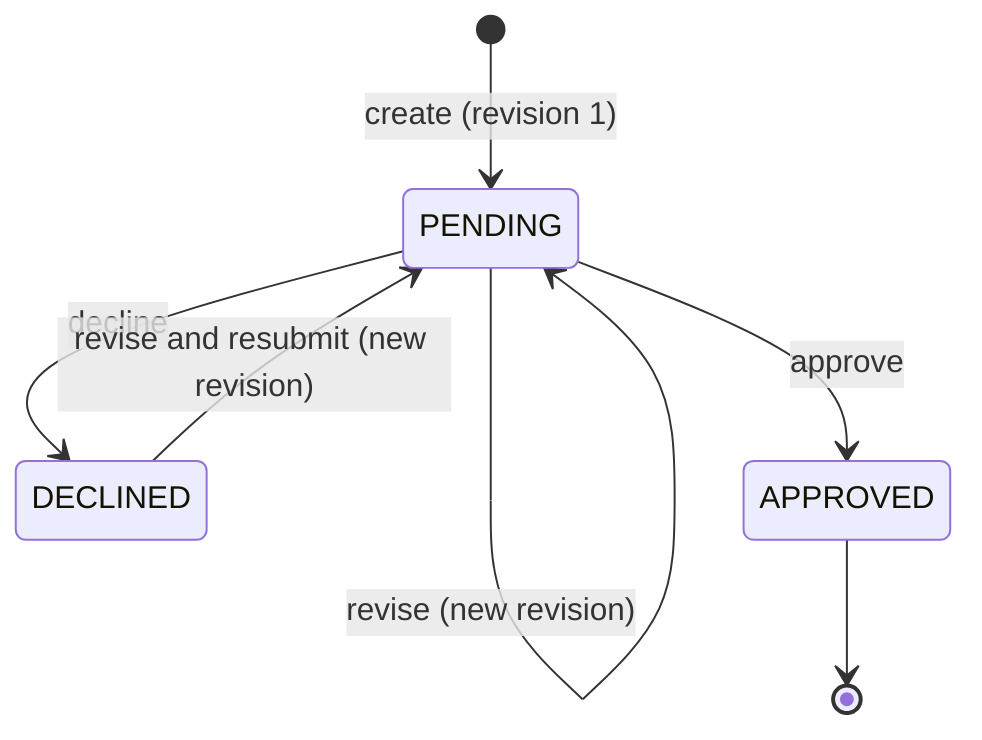

# State model

How a pricing exception request moves between statuses, who can move it, and the rules that always hold.

## States

- `PENDING`: waiting for a decision on the latest revision.
- `DECLINED`: the latest revision was declined. The creator can revise and resubmit.
- `APPROVED`: the latest revision was approved. Terminal.

## Two numbers on a request

- **Revision number** identifies the content: discount and reason. It starts at 1 and increases with every revise.
- **Version** tells a client whether the request changed since they looked at it. It starts at 1 and increases with every revise and every decision.

Clients send the version they saw. The server binds a decision to the latest revision after checking the version.

## Transitions

| Transition | Who | Precondition | Effect | Errors |
|---|---|---|---|---|
| create | Relationship manager | Application exists and has no request | Request in `PENDING`, revision 1, version 1 | `APPLICATION_NOT_FOUND`, `REQUEST_ALREADY_EXISTS`, `IDEMPOTENCY_KEY_REUSED` |
| revise | The manager who created the request | Status is `PENDING` or `DECLINED`; version is current | New revision; status `PENDING`; version +1 | `NOT_REQUEST_OWNER`, `STALE_VERSION`, `INVALID_STATE` |
| approve | A reviewer who did not create the request | Status is `PENDING`; version is current | Decision row on the latest revision; status `APPROVED`; version +1 | `FOUR_EYES_VIOLATION`, `STALE_VERSION`, `INVALID_STATE` |
| decline | A reviewer who did not create the request | Status is `PENDING`; version is current | Decision row on the latest revision; status `DECLINED`; version +1 | `FOUR_EYES_VIOLATION`, `STALE_VERSION`, `INVALID_STATE` |

Every transition checks its precondition and applies its effect in one write transaction.

The "has no request" precondition applies to a new creation. A valid idempotent replay is handled before that check and returns the stored original response, so a retry is never answered with `REQUEST_ALREADY_EXISTS`.

`INVALID_STATE` replaces the `NOT_PENDING` code named in the working plan. A declined request can be revised, so "not pending" was the wrong name for a revise that fails on an approved request.

## Example

| Step | Action | Status | Revision | Version |
|---|---|---|---|---|
| 1 | Manager creates a request for 35 bps | `PENDING` | 1 | 1 |
| 2 | Reviewer declines | `DECLINED` | 1 | 2 |
| 3 | Manager revises to 20 bps | `PENDING` | 2 | 3 |
| 4 | Reviewer approves | `APPROVED` | 2 | 4 |

History after step 4: two revisions and two decisions. The mortgage process reads 20 bps, from revision 2.

## Invariants

These always hold. They are the input for the tests and for the invariant guard agent.

| Id | Invariant |
|---|---|
| I1 | An application has at most one request. |
| I2 | A revision never changes. Content changes only by adding a revision. |
| I3 | Every successful revise or decision requires the current version and increments it exactly once. |
| I4 | A rejected operation changes neither the request nor its history. |
| I5 | A decision is made only on the latest revision, while the request is `PENDING`. |
| I6 | A revision has at most one decision. |
| I7 | `APPROVED` is terminal: no revise and no further decision. |
| I8 | Revisions and decisions are append-only and are written in the same transaction as the status and version change, so status, version and history always agree. The current status matches the latest revision: no decision means `PENDING`, a decline decision means `DECLINED`, and an approval decision means `APPROVED`. Decisions on older revisions remain historical. |
| I9 | Only a relationship manager who created the request can revise it. Only a reviewer who is not the creator can decide. The deciding user and the decision time are set by the server. |
| I10 | Within the same caller scope, replaying a successfully committed create with the same key and validated fields returns the stored original response without changing any state. The same key with different fields is rejected. |
| I11 | The approved discount exposed to the mortgage process is the value of the approved revision. No approved discount is exposed through the downstream endpoint unless the request is `APPROVED`. |

## Left for the API contract

- Error codes for an unknown user and for a caller whose role does not allow the action.
- The order in which checks run when several would fail at once.
