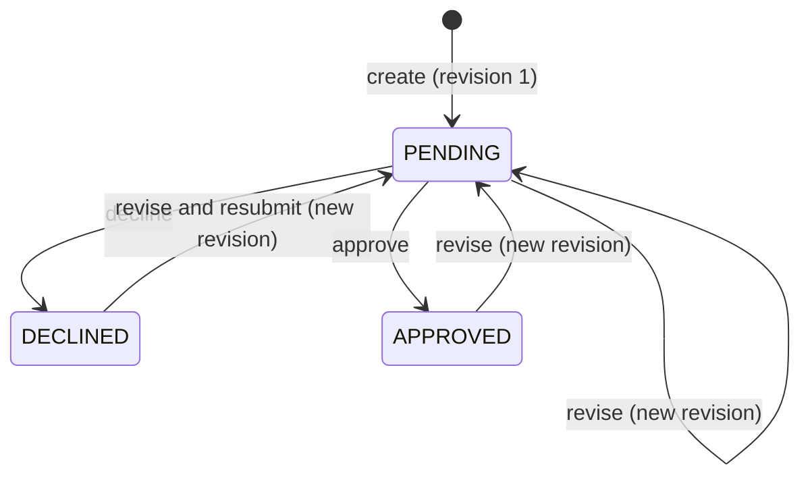

# State model

How a pricing exception request moves between statuses, who can move it, and the rules that always hold.

## States

- `PENDING`: waiting for a decision on the latest revision.
- `DECLINED`: the latest revision was declined. The creator can revise and resubmit.
- `APPROVED`: the latest revision was approved. The creator can revise again.

The status describes the latest revision only. Which discount can be used is a separate question:

**The approval in force** is the approved revision with the highest number. It is not the highest discount and not the latest revision. A request whose latest revision is `PENDING` or `DECLINED` still has an approval in force if an earlier revision was approved. `DECLINED` means that the latest proposal was declined, not that an earlier approval was cancelled.

## Two numbers on a request

- **Revision number** identifies the content: discount and reason. It starts at 1 and increases with every revise.
- **Version** tells a client whether the request changed since they looked at it. It starts at 1 and increases with every revise and every decision.

Clients send the version they saw. The server binds a decision to the latest revision after checking the version.

## Transitions

| Transition | Who | Precondition | Effect | Errors |
|---|---|---|---|---|
| create | Relationship manager | Application exists and has no request | Request in `PENDING`, revision 1, version 1 | `APPLICATION_NOT_FOUND`, `REQUEST_ALREADY_EXISTS`, `IDEMPOTENCY_KEY_REUSED` |
| revise | The manager who created the request | Version is current; possible in every status | New revision; status `PENDING`; version +1; the approval in force does not change | `NOT_REQUEST_OWNER`, `STALE_VERSION` |
| approve | A reviewer who did not create the request | Status is `PENDING`; version is current | Decision row on the latest revision; status `APPROVED`; version +1; this revision becomes the approval in force | `FOUR_EYES_VIOLATION`, `STALE_VERSION`, `INVALID_STATE` |
| decline | A reviewer who did not create the request | Status is `PENDING`; version is current | Decision row on the latest revision; status `DECLINED`; version +1; the approval in force does not change | `FOUR_EYES_VIOLATION`, `STALE_VERSION`, `INVALID_STATE` |

Every transition checks its precondition and applies its effect in one write transaction.

The "has no request" precondition applies to a new creation. A valid idempotent replay is handled before that check and returns the stored original response, so a retry is never answered with `REQUEST_ALREADY_EXISTS`.

`INVALID_STATE` is the answer to a decision on a request that is not `PENDING`. A revise is possible in every status, so it never gets this code.

## Example

Open [story.html](story.html) in a browser to walk these steps.

| Step | Action | Status | Revision | Version |
|---|---|---|---|---|
| 1 | Manager creates a request for 40 bps | `PENDING` | 1 | 1 |
| 2 | Reviewer declines | `DECLINED` | 1 | 2 |
| 3 | Manager revises to 20 bps | `PENDING` | 2 | 3 |
| 4 | Manager revises to 25 bps while the request is still pending | `PENDING` | 3 | 4 |

History after step 4: revision 1 was declined, revision 2 was never decided, and revision 3 is waiting. The mortgage process reads nothing. A decision sent with version 3 is refused with `STALE_VERSION`: it cannot approve the 25 bps the reviewer has not seen.

The negotiation can go on after an approval:

| Step | Action | Status | Revision | Version | Approval in force |
|---|---|---|---|---|---|
| 5 | Reviewer approves | `APPROVED` | 3 | 5 | 25 bps, revision 3 |
| 6 | Manager revises to 35 bps | `PENDING` | 4 | 6 | 25 bps, revision 3 |
| 7 | Reviewer declines | `DECLINED` | 4 | 7 | 25 bps, revision 3 |
| 8 | Manager revises to 30 bps | `PENDING` | 5 | 8 | 25 bps, revision 3 |
| 9 | Reviewer approves | `APPROVED` | 5 | 9 | 30 bps, revision 5 |

## Invariants

These always hold. They are the input for the tests and for the invariant guard agent.

| Id | Invariant |
|---|---|
| I1 | An application has at most one request. |
| I2 | A revision never changes. Content changes only by adding a revision. |
| I3 | Every successful revise or decision requires the current version and increments it exactly once. |
| I4 | A rejected operation changes neither the request nor its history. |
| I5 | A decision is made only on the latest revision, while the request is `PENDING`. |
| I6 | A revision has at most one decision. |
| I7 | An approved revision gets no further decision. Its decision is never removed. It stays the approval in force until a later revision is approved. |
| I8 | Revisions and decisions are append-only and are written in the same transaction as the status and version change, so status, version and history always agree. The current status matches the latest revision: no decision means `PENDING`, a decline decision means `DECLINED`, and an approval decision means `APPROVED`. Decisions on older revisions are kept unchanged; which approval is in force is defined by I11. |
| I9 | Only a relationship manager who created the request can revise it. Only a reviewer who is not the creator can decide. The deciding user and the decision time are set by the server. |
| I10 | Within the same caller scope, replaying a successfully committed create with the same key and validated fields returns the stored original response without changing any state. The same key with different fields is rejected. |
| I11 | The discount exposed to the mortgage process is the value of the approval in force: the approved revision with the highest number. A pending or declined revision is never exposed; without an approved revision nothing is exposed. |

## Related

[api-contract.md](api-contract.md) defines the endpoints, the remaining error codes (unknown user, role not allowed) and the order in which checks run when several would fail at once.
