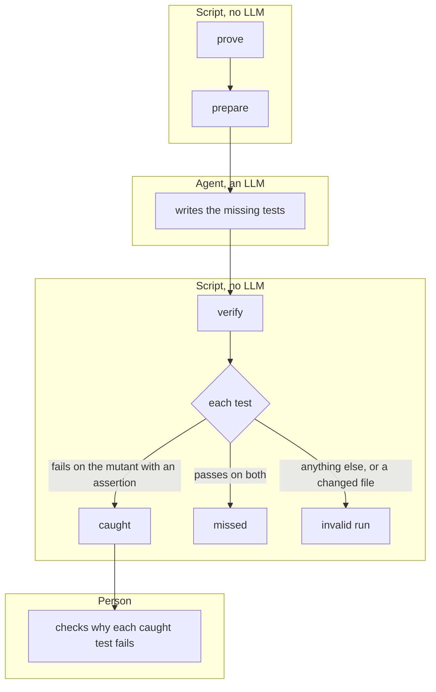

# Invariant guard

A controlled experiment: given a change and the domain rules, an agent writes the regression tests that are missing. To check whether it works, we break one rule on purpose (a mutant), hide the tests that would catch it, and measure whether the agent's tests catch it. Writing the tests needs an LLM. Checking them does not.

One experiment, and who runs each step. `generate.py` starts the agent, which cannot run commands and writes only under `tests/`.



Requires Docker. Run from the repository root. The commands take the name of a mutant; the examples use the first one.

```bash
python guard/harness.py prove stale_approval            # the mutant breaks exactly its reference tests
python guard/harness.py calibrate stale_approval        # the harness classifies known tests correctly
python guard/harness.py prepare stale_approval /tmp/ws  # the agent's copy, with the gap checked
python guard/generate.py stale_approval /tmp/ws guard/runs/<date>-stale_approval   # needs Claude Code
python guard/harness.py verify stale_approval /tmp/ws   # classify the agent's tests
python guard/harness.py replay stale_approval guard/runs/2026-10-03-stale-approval  # re-check a recorded run
```

| File | What it is |
|---|---|
| `mutants.toml`, `mutants/` | Each mutant, the rule it breaks, its reference tests and its baseline: the commit its runs start from |
| `prompt.md` | The agent's instructions |
| `harness.py` | LLM-free: prove, prepare, verify, calibrate, replay |
| `generate.py` | Runs the agent with restricted permissions and records the run |
| `calibration/` | Five tests with known results: caught, missed, and three kinds of invalid run |
| `runs/` | Recorded runs: prompt, command, transcript, the agent's tests, result |

The workspace must be outside any `.claude` directory: the agent is not allowed to write there.

What `caught` means: the agent's test passes on the baseline and fails on the mutant with an assertion. The harness checks only that it is an assertion. Whether the assertion is about the rule the mutant breaks is confirmed by a person and recorded in the run's `result.md`.

| Mutant | Rule | Baseline | Recorded run |
|---|---|---|---|
| `stale_approval` | I3, I5: a decision needs the current version | `229ad61`, the domain core | `runs/2026-10-03-stale-approval` |
| `idempotent_replay` | I10: a create sent again with the same key and fields returns the first response | `33dd38a`, the complete API | `runs/2026-10-05-idempotent-replay` |

A run is an `invalid run` when the agent changed any existing file, when its file runs tests defined elsewhere (for example by importing them), when pytest does not end normally, or when it times out. `calibration/` covers the import, interrupted-run and collection-error cases; run `calibrate` after changing the harness.

## Limits of the harness

- **Calibration uses the first mutant only.** The five samples are domain tests for `stale_approval`, so `calibrate idempotent_replay` cannot pass. For API tests the evidence is `prove`: it runs the whole suite in the same container and finds exactly the reference tests failing.
- **The test image comes from the working tree.** It is built from the current `requirements-dev.txt`, not from the baseline's. Both baselines have the same file today.
- **Withholding a test leaves traces.** Only the test functions are removed from the agent's copy. An import nothing uses any more, or a section comment, can show that something is missing. Each run's `result.md` says what was visible.
- **The list of hidden files is checked by hand.** `HIDDEN_FROM_AGENT` in `harness.py` is one list for all mutants, and a path that does not exist is skipped. It is read again for every new baseline.
- **`replay` refuses a run recorded for another mutant or baseline**, so a change to `mutants.toml` cannot silently move a recorded run onto other code.
